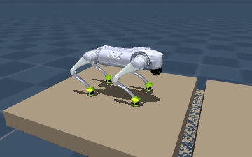
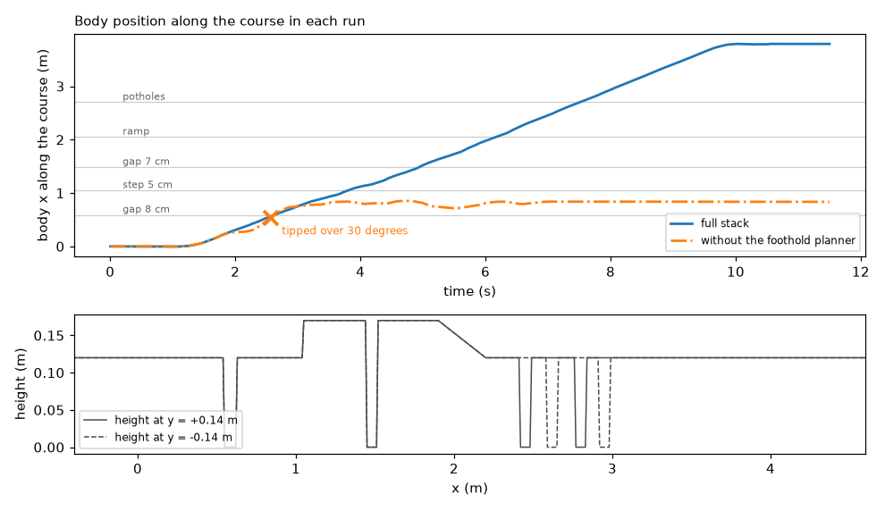
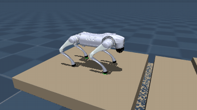
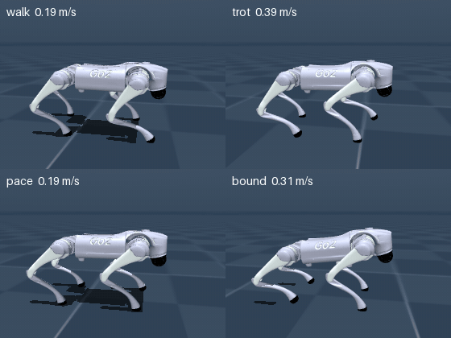
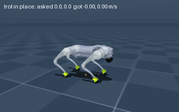
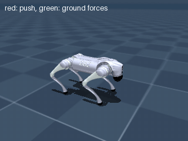

# quadruped-locomotion-mujoco

The four main parts of a legged robot's walking software, each built small and then joined into
one working stack, on the Unitree Go2 robot model in the MuJoCo simulator. Written in 2026, in
Python. Everything runs in simulation. No real robot was used.



## The four parts

| Part | What it does | Folder | Its own demo |
|---|---|---|---|
| Foothold planner | picks a safe spot for each foot on a ground map: not in a gap, not on an edge | `footholds/` | `python -m footholds.demo --gait trot` |
| Gait scheduler | decides when each foot lifts and lands, and swings it along a smooth curve | `gait/` | `python -m gait.demo trot` |
| MPC | plans how hard each planted foot pushes, looking 0.36 s ahead | `mpc/` | `python -m mpc.demo --view` |
| Whole body controller | turns the pushes and swings into the 12 motor torques, within the motor limits | `wbc/` | `python -m wbc.demo push --view` |

`stack/` runs all four together: `python -m stack.demo`.

## All four together

Every 2 ms:

1. The gait clock says which feet are down now and which lift next.
2. When a foot lifts, the foothold planner picks where it lands, and a smooth curve takes it there.
3. Every 30 ms, and whenever the gait clock puts a foot down or lifts one, the MPC plans how hard
   each planted foot pushes.
4. The whole body controller turns those pushes and the swing curves into 12 motor torques.
5. MuJoCo moves the robot.

The course has an 8 cm gap, a 5 cm step, a 7 cm gap on the step, a ramp and four potholes. Trotting
at a commanded 0.4 m/s, the full stack got across: 3.79 m, no fall and no foot in a hole. Without
the foothold planner, with each foot landing on its first guess, one front foot was aimed into the
first gap at 1.7 s and the other dropped into it at 2.2 s. The body tipped past 30 degrees, up to
59, which the code counts as a fall from 2.6 s, and the robot then stayed stuck at the gap.



## Each part on its own

**Foothold planner.** When a foot lifts, it first guesses where it should land (under the hip, a
little ahead). Then it scores the ground within 10 cm of that guess, 1 cm at a time, and picks the
best spot: away from gaps and edges, flat, and close to the guess. Here it drives the gait part's
simple joint control. With it the trot crossed the course in 12 s without a foot in a hole.
Landing on the first guesses, a front foot dropped into the first gap at 2.1 s and the robot fell
at 3.2 s.




**Gait scheduler.** One clock for the whole robot, with an offset for each leg. Walk, trot, pace
and bound are the same code with different settings: the leg offsets, the length of one cycle and
how long each foot stays down (in the walk three feet are always down). Each swing follows a
smooth curve, and the leg IK turns each foot position into three joint angles. In this demo every
leg simply follows its foot path with joint angles, with no force planning, so the speed is not
controlled: the trot reaches 0.39 m/s for a commanded 0.5 m/s.



**MPC.** Every 30 ms it treats the whole robot as one block and plans the pushes of the planted
feet over the next 0.36 s, so the block moves at the commanded speed and stays level. Here it
drives the legs with simple torques, without the whole body controller. It followed 0.5 m/s at
0.51 m/s and 1.0 m/s at 1.05 m/s, stepped sideways and turned. A plan usually took the OSQP
solver under 2 ms, and never more than about 6 ms (the MPC plans every 30 ms).



**Whole body controller.** It finds the 12 motor torques that give the pushes it is asked for,
keep the planted feet still and stay within the motor limits, as one small optimisation, 500 times
a second. Standing, it followed body pose targets within about 1 degree and 1 mm, and recovered
from 0.1 s pushes of up to 125 N sideways (130 N tipped it over). On three feet it moved the fourth
along a circle in the air within 4 mm.



## Run it

Tested on Ubuntu 24.04 with Python 3.12 and an NVIDIA RTX 5060.

```bash
./get_model.sh                       # downloads the Go2 model (about 8 MB, 38 MB on disk)
python3 -m venv .venv
.venv/bin/pip install -r requirements.txt
.venv/bin/python -m stack.demo       # opens the MuJoCo viewer: all four parts on the course
```

The foothold, gait and stack demos open the viewer, the MPC and whole body controller demos need
`--view`, and any demo writes a GIF instead with `--gif file.gif`. The viewer of the foothold, MPC,
whole body controller and stack demos draws the discs, arrows and dots live, and so do the clips
that `make_media.py` writes. A demo's `--gif` shows the robot only, except for the stack demo.

```bash
.venv/bin/python -m stack.demo --raibert-only     # without the foothold planner
.venv/bin/python -m stack.demo --flat --vx 0.4    # flat ground, one speed
.venv/bin/python make_media.py                    # every GIF and plot in media/
.venv/bin/python -m pytest                        # 69 tests, about 50 s
```

## Files

| Folder | What is in it |
|---|---|
| `footholds/` | the ground map (`terrain.py`), the spot picking (`planner.py`), a walker that uses it with the gait part |
| `gait/` | the gait clock and swing curves (`scheduler.py`), the simple joint controller (`joint_pd.py`) |
| `mpc/` | the MPC (`mpc.py`) and a trot controller that uses it with simple leg torques |
| `wbc/` | the whole body controller (`wbc.py`) and its standing runs: pose moves, pushes, three feet (`scenarios.py`) |
| `stack/` | all four parts together (`stack.py`) |
| `common/` | robot model loading, leg IK, video helpers, and the fall and foot-in-a-hole checks (`metrics.py`) |
| `tests/`, `media/` | the tests, and the GIFs and plots |

`footholds/`, `gait/`, `mpc/`, `wbc/` and `stack/` each have a `demo.py`, run as
`python -m <folder>.demo`.

## The robot model

The Unitree Go2 model comes from MuJoCo Menagerie (github.com/google-deepmind/mujoco_menagerie,
folder `unitree_go2`). Menagerie made it from Unitree Robotics' published robot description, and it
is under the BSD-3-Clause licence (copyright Unitree Robotics). `get_model.sh` downloads it at
commit 370c439 into `third_party/`. It is not copied into this repo.

## Limits

- Simulation only, in MuJoCo 4.0.1. Nothing here ran on a real robot.
- The controllers read the robot's true position and speed from the simulator, and the planner
  gets the exact ground map. A real robot would have to estimate both from its sensors.
- With all four parts the robot runs about 12 to 16 % faster than commanded on flat ground
  (0.231 m/s for 0.2, 0.448 for 0.4, 0.674 for 0.6, as `python -m stack.demo --flat --vx ...`
  prints, averaged from second 3 to second 9 after a standing start), and starting straight into
  0.6 m/s tilts the body by up to 29 degrees. Going forward, the MPC with its own simple leg
  control stays within 5 %, so the extra speed comes with the whole body controller. A lower swing
  or moving the footholds during the swing did not remove it (a lower swing even made it a little
  larger). I have not found the cause.
- The full stack was run with the trot only, straight ahead. The planner chooses one step at a
  time, with no look-ahead.
